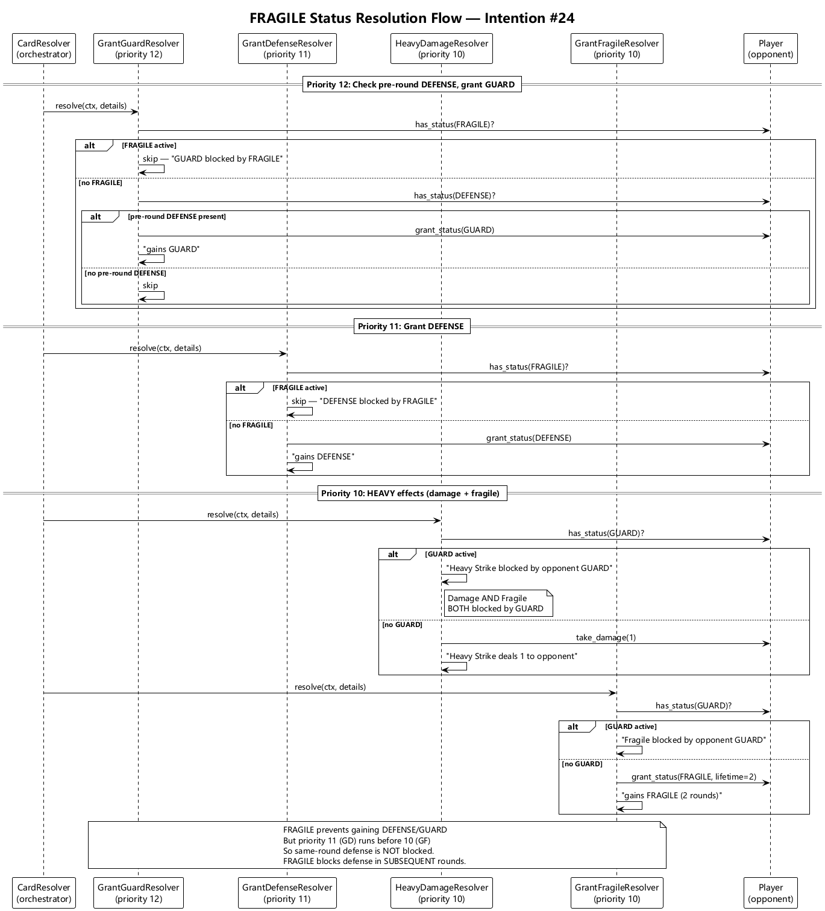
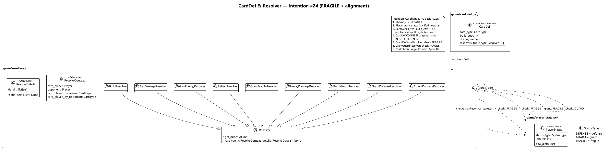

# Architecture Design — 卡牌定义对齐 card.md (intention #24)

## 1. Motivation

`intention/card.md` 成为卡牌定义的唯一真相源。当前 `card_def.py` 和 `resolver/` 中的代码未完全对齐该文件。本次重构将代码与 card.md 严格对齐，涉及以下变更：

- **重击 (HEAVY)**：build_cost 从 1 改为 2；新增赋予对方**脆弱**状态的效果
- **防守反击 (COUNTER)**：display_name 从"反击"改为"防守反击"
- **脆弱状态 (FRAGILE)**：新增状态类型，玩家持有脆弱时无法获得防御和联防效果
- **攻击 (ATTACK)**：修复 card.md 文档笔误（"1点" → "x点"），代码逻辑无需变更（当前 `min(streak+1, 3)` 已符合语义）

## 2. Module Impact

| 文件 | 变更 |
|------|------|
| `game/player_state.py` | **修改** — `StatusType` 枚举新增 `FRAGILE` |
| `game/player.py` | **修改** — `grant_status()` 增加 `lifetime` 参数（默认 1） |
| `game/card_def.py` | **修改** — HEAVY `build_cost` 1→2；COUNTER `display_name` "反击"→"防守反击"；HEAVY `resolvers` 新增 `GrantFragileResolver` |
| `game/resolver/grant_fragile_resolver.py` | **新建** — 赋予脆弱状态（priority 10, lifetime=2, 被 GUARD 阻挡） |
| `game/resolver/grant_defense_resolver.py` | **修改** — resolve() 增加 FRAGILE 检查，持有脆弱时跳过 |
| `game/resolver/grant_guard_resolver.py` | **修改** — resolve() 增加 FRAGILE 检查，持有脆弱时跳过 |
| `game/resolver/__init__.py` | **修改** — 新增 `GrantFragileResolver` 导出 |

不需要变更：`controller/`、`ai/`、`app/converter.py`、`log/`、`config/`。Converter 的 `_BUILD_COST` 和 `_CARD_MAP` 已从 CardDef 动态派生，HEAVY build_cost 变更自动传播。

## 3. Key Design Decisions

**D1 — FRAGILE 状态仅阻止"获得"，不影响已有状态。** 卡片结算时，优先级 11 的 GrantDefenseResolver 和优先级 12 的 GrantGuardResolver 先于优先级 10 的 GrantFragileResolver 执行。因此同回合内防御状态先于脆弱赋予生效，脆弱从下一回合开始阻止新防御/联防的获得。这与 card.md "无法获得防御和联防效果" 语义一致。

**D2 — GrantFragileResolver 同样受 GUARD 阻挡。** card.md 重击效果 "除非对方有联防状态，否则对对方造成1点伤害，并赋予对方持续2回合的脆弱状态" 中，"并" 连接的两个效果共享同一个条件。GrantFragileResolver（priority 10）与 HeavyDamageResolver（priority 10）均检查 GUARD。

**D3 — grant_status() 增加 lifetime 参数。** 当前 grant_status() 固定 lifetime=1。脆弱状态需要 lifetime=2。修改签名 `grant_status(status_type, lifetime=1)` 保持向后兼容。

**D4 — 仅变更 game 层。** 本次变更不涉及 CardType 枚举值变化（COUNTER 的枚举值仍为 "counter"），因此 `converter.py`、`model.py`、`app_manager.py`、`selfplay_runner.py` 无需变更。前端仅需适配新的 display_name 和 FRAGILE 状态显示。

## 4. CardDef 变更对照

| CardType | 字段 | 旧值 | 新值 |
|----------|------|------|------|
| HEAVY | build_cost | 1 | 2 |
| HEAVY | resolvers | `(HeavyDamageResolver,)` | `(HeavyDamageResolver, GrantFragileResolver)` |
| COUNTER | display_name | "反击" | "防守反击" |

其余 CardDef（ATTACK、DEFENSE、ENERGY、BUILD、FLEX）不变。

## 5. Key Flows

- **脆弱状态结算流程**: 
  详见：[fragile_flow.puml](diagrams/fragile_flow.puml)
- **类图及依赖关系**: 
  详见：[class_diagram.puml](diagrams/class_diagram.puml)
