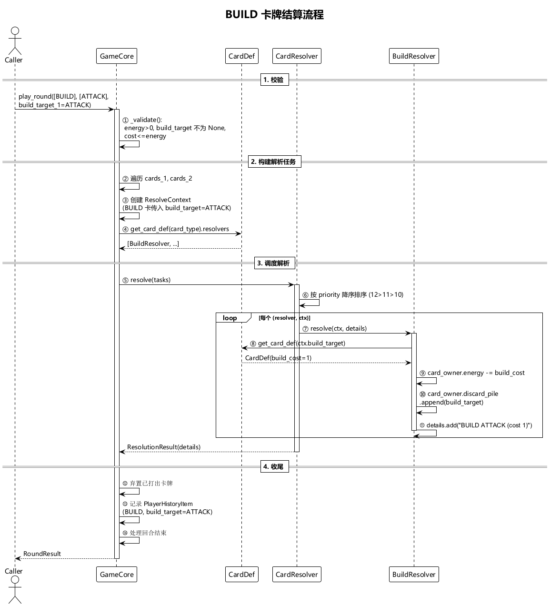
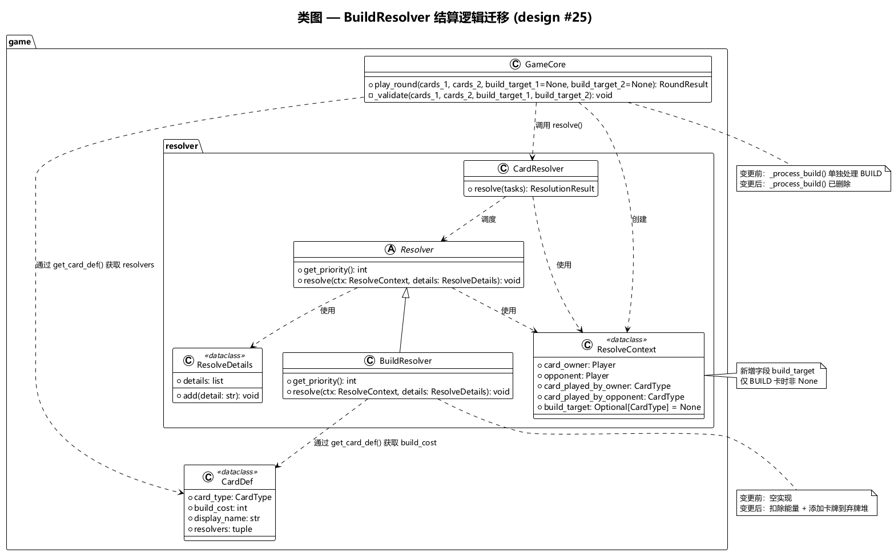

# Architecture Design — BuildResolver 结算逻辑迁移 (intention #25)

## 1. Motivation

当前 `BuildResolver.resolve()` 是空实现，实际 BUILD 卡牌的结算逻辑（扣除能量、添加卡牌到弃牌堆）在 `GameCore._process_build()` 中。`ResolveContext` 缺少 `build_target` 字段，无法将构建目标传递给解析器。

本次重构将 BUILD 结算逻辑从 `GameCore` 迁移至 `BuildResolver`，使所有卡牌效果结算统一由 Resolver 体系处理。

## 2. Module Impact

| 文件 | 变更 |
|------|------|
| `game/resolver/base.py` | **修改** — `ResolveContext` 新增 `build_target: CardType \| None = None` 字段 |
| `game/resolver/build_resolver.py` | **修改** — `resolve()` 实现实际结算逻辑：扣除能量 + 添加卡牌到弃牌堆 |
| `game/game_core.py` | **修改** — `play_round()` 创建任务时传入 `build_target`；删除 `_process_build()` 方法及其调用 |

不需要变更：`card_def.py`、`card_type.py`、`resolver/__init__.py`、其余 Resolver 子类、`controller/`、`ai/`、`app/`、`log/`、`config/`。

## 3. Key Design Decisions

**D1 — ResolveContext 新增 build_target 字段。** 采用 `CardType | None` 类型，默认为 `None`。仅当 `card_type == CardType.BUILD` 时由 `play_round()` 赋值为实际的构建目标。非 BUILD 卡牌对应的 `ResolveContext` 中该字段为 `None`，不影响其他 Resolver。

**D2 — BuildResolver.resolve() 自主结算。** `resolve()` 从 `ctx.build_target` 获取构建目标，通过 `get_card_def(build_target).build_cost` 获取消耗，直接修改 `ctx.card_owner` 的 energy 和 discard_pile。这与 `GainEnergyResolver` 等其他 Resolver 的设计模式一致。

**D3 — 删除 _process_build()，统一结算入口。** 删除 `GameCore._process_build()` 方法。所有卡牌效果（含 BUILD）均由 `CardResolver.resolve()` 调度执行，`GameCore.play_round()` 不再有"绕过 Resolver 的单独结算"。

**D4 — 验证逻辑不变。** `_validate()` 中对 BUILD 的能量检查（energy>0、build_target 不为 None、build_cost <= energy）保持不变，仍在 GameCore 中执行。这属于输入校验，不属于效果结算。

## 4. Key Flows

- **BUILD 卡结算流程**: 
  详见：[build_flow.puml](diagrams/build_flow.puml)
- **类图及依赖关系**: 
  详见：[class_diagram.puml](diagrams/class_diagram.puml)
