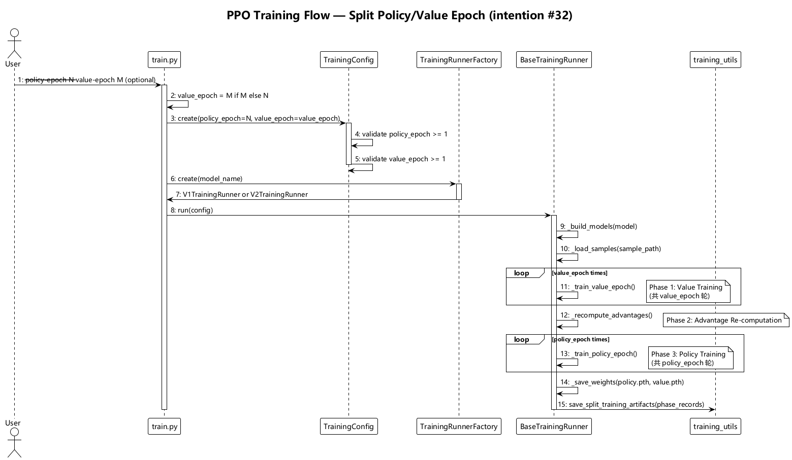
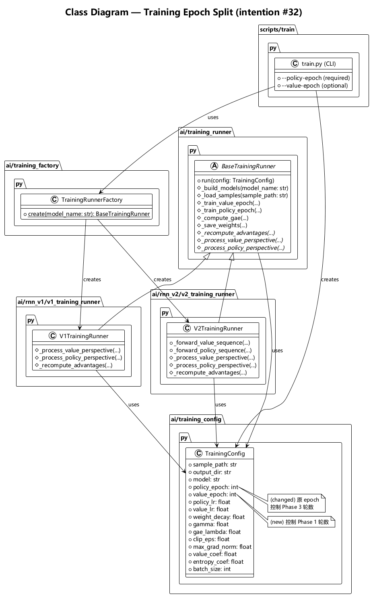

# Architecture Design — 分离 Policy/Value 训练 Epoch (intention #32)

## 1. Motivation

当前 `train.py` 的 `--epoch` 参数同时控制 Phase 1（value 训练）和 Phase 3（policy 训练）的 epoch 数。实践中 policy 网络和 value 网络收敛速度不同，需要独立控制各自的训练轮数。

## 2. Key Design Decisions

**D1 — `--epoch` 拆分为 `--policy_epoch` 和 `--value_epoch`。** `--policy_epoch` 必选，`--value_epoch` 可选（默认等于 `--policy_epoch`），向后兼容。

**D2 — `TrainingConfig.epoch` 拆分为 `policy_epoch` 和 `value_epoch`。** 冻结 dataclass 新增两个字段替代原 `epoch`，`__post_init__` 中各自独立校验 >= 1。

**D3 — `BaseTrainingRunner.run()` 中两个循环各自使用对应 epoch 数。** Phase 1 循环上限改为 `config.value_epoch`，Phase 3 循环上限改为 `config.policy_epoch`。打印信息同步更新。

**D4 — `training_utils.py` 无需修改。** `save_split_training_artifacts` 接收的 `phase_records` 中的 `epoch` 字段来源于循环变量，不受 `TrainingConfig` 字段重命名影响。

## 3. Module Impact

```
src/backend/ai/
├── training_config.py         # MODIFIED — epoch → policy_epoch + value_epoch
├── training_runner.py         # MODIFIED — run() 中两循环使用独立 epoch
├── training_utils.py          # NO CHANGE
├── training_factory.py        # NO CHANGE
├── rnn_v1/v1_training_runner.py   # NO CHANGE
└── rnn_v2/v2_training_runner.py   # NO CHANGE

src/backend/scripts/
└── train.py                   # MODIFIED — CLI 参数重命名 + 新增
```

## 4. Diagrams

### 训练流程交互图



详见：[training_flow.puml](diagrams/training_flow.puml)

### 类图与依赖关系图



详见：[class_diagram.puml](diagrams/class_diagram.puml)
