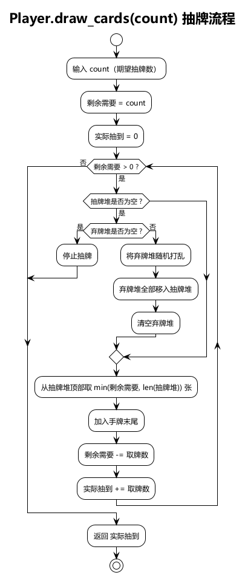
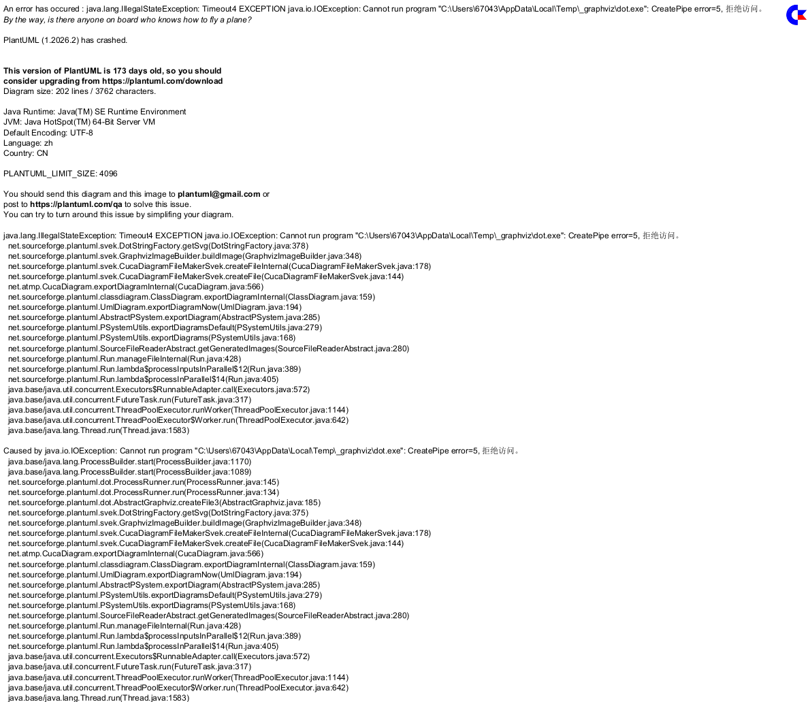

# Architecture Design — 经典 DBG 抽牌机制 (intention #35)

## 1. Motivation

当前抽牌机制（design/26）：每轮 (cycle) 开始时，手牌 → 弃牌堆 → 抽牌堆 → 洗牌 → 抽 5 张。弃牌堆在每轮开始时会自动全部合并到抽牌堆。

本次改为经典 DBG（Deck-Building Game）方式：弃牌堆仅在抽牌堆不足时才洗入，不再在每轮开始时自动合并。这改变了卡牌在牌堆间的流转节奏，使弃牌堆成为一个有意义的缓冲区域。

## 2. Key Design Decisions

**D1 — 新增 `Player.draw_cards(count)` 公有方法。** 实现智能抽牌逻辑：从抽牌堆取牌，若抽牌堆不足则先将弃牌堆洗入抽牌堆再继续，若两堆均空则提前结束。任何需要抽牌的场景均调用此方法。

**D2 — `_start_cycle()` 行为变更。** 每轮开始时，手牌 → 弃牌堆（不变），之后调用 `player.draw_cards(CARDS_PER_CYCLE)` 替代原有的手动合并洗牌逻辑。去掉"弃牌堆 → 抽牌堆"的自动合并步骤。

**D3 — 初始牌堆保持 7 张不变。** 开局 draw pile = 7 → draw 5 → 手牌 5、抽牌堆余 2。Cycle 2 开始时抽牌堆只有 2 张 → 抽完 2 张后不足 → 弃牌堆洗入 → 继续抽满 5。

**D4 — 打出的牌进入弃牌堆（不变）。** 当前的每回合结束弃牌逻辑和 BUILD 构建进弃牌堆逻辑不受影响。

**D5 — CARDS_PER_CYCLE = 5 不变，ROUNDS_PER_CYCLE = 3 不变。** 仅改变抽牌方式，不改变抽牌数量或回合结构。

**D6 — AI 模型结构不变。** 56-d 输入向量中牌堆分布维度（draw_pile 7+7 维、discard_pile 7+7 维）不变。但牌堆分布模式会因新机制改变，旧模型权重需重新训练。

**D7 — 破坏性变更。** 旧存档和旧模型权重与新版抽牌逻辑语义不兼容。

## 3. Module Impact

```
src/backend/
├── game/player.py          # MODIFIED — 新增 draw_cards(count) 公有方法
├── game/game_core.py       # MODIFIED — _start_cycle() 改用 Player.draw_cards()
├── game/game_state.py      # NO CHANGE — pile 字段不变
├── game/round_result.py    # NO CHANGE — 结构不变
├── app/converter.py        # NO CHANGE — 输入向量维度不变
└── ai/                     # NO CHANGE — 模型结构不变，但需重新训练

src/frontend/
└── src/                    # NO CHANGE — 牌堆显示逻辑不变
```

## 4. Interface Changes

详见 [interfaces.md](interfaces.md)。

## 5. Diagrams

### 抽牌流程



详见：[draw_flow.puml](diagrams/draw_flow.puml)

### 类图



详见：[class_diagram.puml](diagrams/class_diagram.puml)

## 6. Test Cases

详见 [test_cases.md](test_cases.md)。
