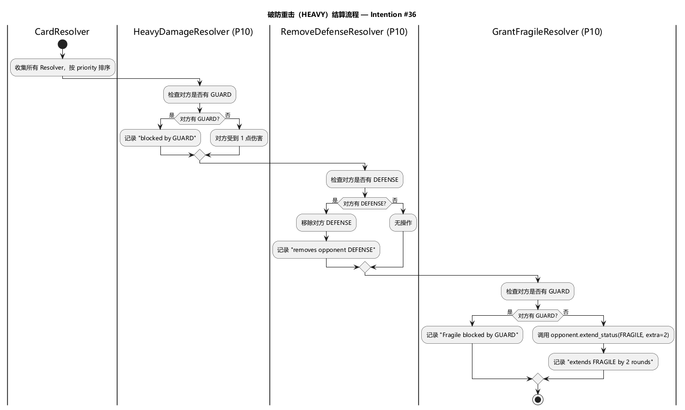
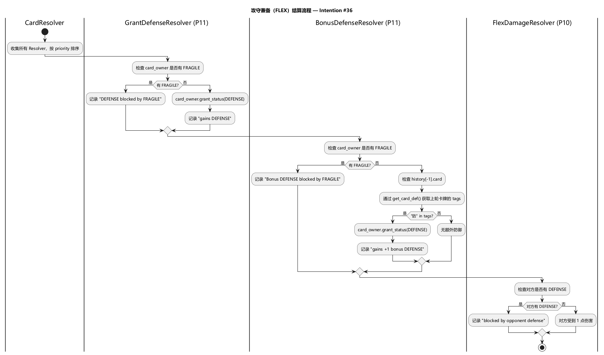
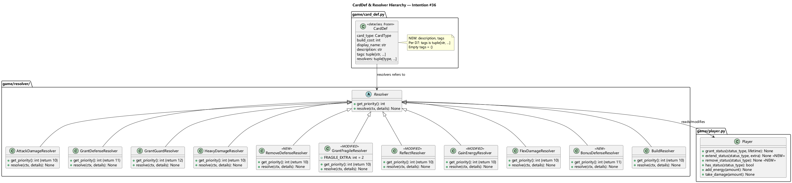

# Architecture Design — 卡牌名字效果变更 + 描述/标签字段 (intention #36)

## 1. Motivation

`intention/card.md` 更新了七张卡牌的定义，涉及：四个 display_name 变更、五张卡牌效果更新、以及为所有卡牌新增 `description` 和 `tags` 字段。CardType 枚举值不变。

## 2. Module Impact

| 文件 | 变更 |
|------|------|
| `game/card_def.py` | **修改** — `CardDef` 新增 `description`、`tags` 字段；`_CARD_DEFS` 更新 display_name、tags、resolvers |
| `game/player.py` | **修改** — 新增 `extend_status()` 方法（用于脆弱累加）；新增 `remove_status()` 方法（用于破防重击移除防御） |
| `game/resolver/gain_energy_resolver.py` | **修改** — 连续聚能额外+1 能量逻辑 |
| `game/resolver/grant_fragile_resolver.py` | **修改** — 脆弱改为累加式（`+2` 而非 `set=2`） |
| `game/resolver/reflect_resolver.py` | **修改** — 条件从检查 CardType 改为检查 tag ("攻") + 对方防御 |
| `game/resolver/remove_defense_resolver.py` | **新建** — 移除对方防御状态（priority 10），仅用于破防重击 |
| `game/resolver/bonus_defense_resolver.py` | **新建** — FLEX 额外+1 防御（priority 11），上轮打出"防"标签卡时触发 |
| `game/resolver/__init__.py` | **修改** — 新增 `RemoveDefenseResolver`、`BonusDefenseResolver` 导出 |
| `controller/api.py` | **修改** — `GET /api/cards` 响应新增 `description`、`tags` 字段 |
| `controller/serializers.py` | 不变 — CardType 枚举值不变，序列化无影响 |

不需要变更：`ai/`、`app/converter.py`、`log/`、`config/`、`game/card_type.py`、`game/game_core.py`。

## 3. Key Design Decisions

**D1 — CardType 枚举值不变。** ATTACK/DEFENSE/HEAVY/COUNTER/ENERGY/BUILD/FLEX 的枚举值 `"attack"` 等保持不变。仅 `display_name` 更新。确保 AI 训练数据、旧存档、前后端 API 契约完全兼容。

**D2 — "本轮打出过..." 排除当前卡。** card.md 中所有"本轮及上轮有打出过 X"的判定，均不包含当前正在结算的卡牌。实现时通过 `card_owner.history[-1]` 获取上轮卡牌，而非当前轮。

**D3 — 脆弱"回合数 +2"为累加式。** `GrantFragileResolver` 不再直接 `grant_status(lifetime=2)`，而是对已有 FRAGILE 状态调用 `Player.extend_status(StatusType.FRAGILE, 2)` 延长生命周期。无 FRAGILE 时等价于初始 lifetime=2。

**D4 — ReflectResolver 使用标签判定反击条件。** 反击条件从"对方卡牌 == ATTACK or HEAVY"改为"对方卡牌含 '攻' 标签 **且** 对方无防御状态"。需通过 `get_card_def()` 获取对方卡牌的 tags。

**D5 — FLEX 额外防御通过独立 Resolver 实现。** 新建 `BonusDefenseResolver`（P11），与 `GrantDefenseResolver` 同优先级但排在注册顺序之后，确保基础防御先于额外防御结算。FLEX 的 `resolvers` 顺序为 `(GrantDefenseResolver, BonusDefenseResolver, FlexDamageResolver)`。

**D6 — COUNTER 新增 GrantGuardResolver。** COUNTER 获得与 DEFENSE 相同的联防机制（效果3），`resolvers` 变为 `(GrantDefenseResolver, ReflectResolver, GrantGuardResolver)`。

**D7 — tags 使用不可变元组。** `CardDef` 为 frozen dataclass，`tags` 字段类型为 `tuple[str, ...]`，无标签时为 `()`。

## 4. CardDef 变更对照

| CardType | 字段 | 旧值 | 新值 |
|----------|------|------|------|
| ATTACK | display_name | "攻击" | "连续击" |
| ATTACK | tags | — | `("攻",)` |
| DEFENSE | display_name | "防御" | "格挡" |
| DEFENSE | tags | — | `("防",)` |
| HEAVY | display_name | "重击" | "破防重击" |
| HEAVY | tags | — | `("攻",)` |
| HEAVY | resolvers | `(HeavyDamageResolver, GrantFragileResolver)` | `(HeavyDamageResolver, RemoveDefenseResolver, GrantFragileResolver)` |
| COUNTER | resolvers | `(GrantDefenseResolver, ReflectResolver)` | `(GrantDefenseResolver, ReflectResolver, GrantGuardResolver)` |
| COUNTER | tags | — | `("防",)` |
| ENERGY | tags | — | `()` |
| BUILD | tags | — | `()` |
| FLEX | resolvers | `(GrantDefenseResolver, FlexDamageResolver)` | `(GrantDefenseResolver, BonusDefenseResolver, FlexDamageResolver)` |
| FLEX | tags | — | `("攻", "防")` |

所有 CardDef 新增 `description` 字段（值见 card.md "描述"行）。

## 5. Key Flows

- **破防重击结算流程**: 
  详见：[heavy_flow.puml](diagrams/heavy_flow.puml)
- **攻守兼备结算流程**: 
  详见：[flex_flow.puml](diagrams/flex_flow.puml)
- **类图及依赖关系**: 
  详见：[class_diagram.puml](diagrams/class_diagram.puml)
