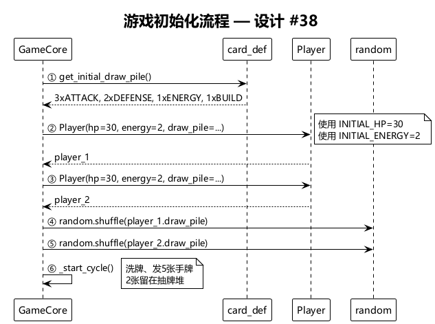
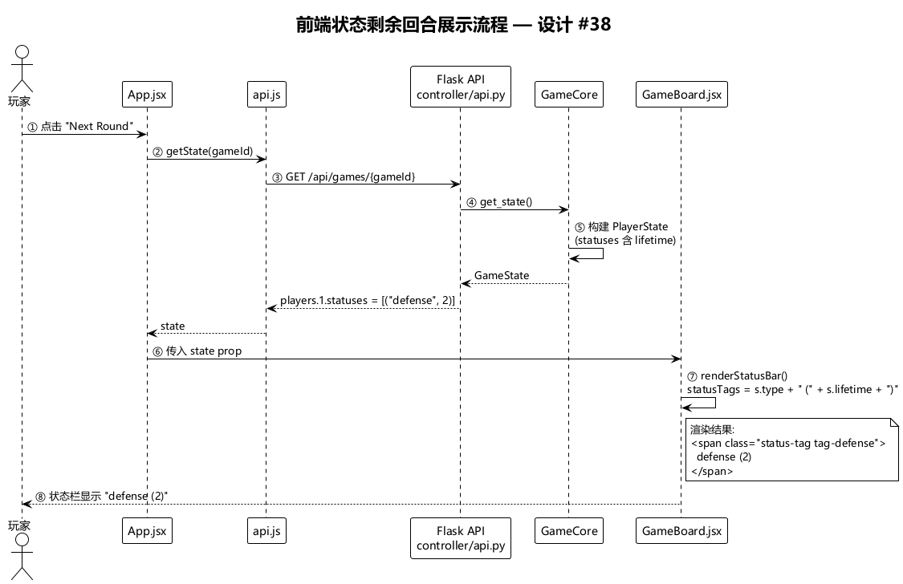
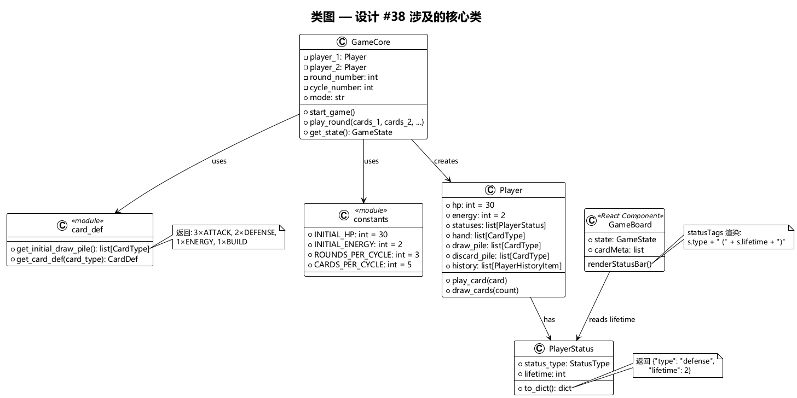
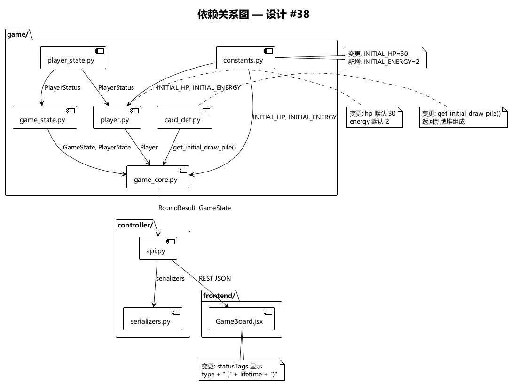

# 设计 #38 — 初始游戏参数调整 & 状态剩余回合展示

## 1. 概述

调整游戏的三个初始参数（抽牌堆、生命值、能量），并在前端状态栏中展示状态的剩余回合数。

## 2. 变更清单

| 项目 | 当前值 | 目标值 |
|------|--------|--------|
| 初始抽牌堆 | 2×连续击, 1×格挡, 1×破防重击, 1×防守反击, 1×聚能, 1×构建/拆解 | 3×连续击, 2×格挡, 1×聚能, 1×构建/拆解 |
| 初始生命值 | 20 | 30 |
| 初始能量 | 0 | 2 |
| 前端状态展示 | 仅显示状态类型（defense / guard） | 显示状态类型 + 剩余回合数 |

## 3. 关键流程

### 3.1 游戏初始化流程

详见：[game_init.puml](diagrams/game_init.puml)

`GameCore.start_game()` 调用 `get_initial_draw_pile()` 获取新牌堆，使用 `INITIAL_HP`（30）和 `INITIAL_ENERGY`（2）初始化玩家。

### 3.2 前端状态展示流程

详见：[status_display.puml](diagrams/status_display.puml)

后端 `PlayerStatus.to_dict()` 已序列化 `{"type": "defense", "lifetime": N}`。前端 `GameBoard` 的 `statusTags` 渲染逻辑扩展为同时展示 `type` 和 `lifetime`。

## 4. 类图

详见：[class_diagram.puml](diagrams/class_diagram.puml)

## 5. 依赖关系

详见：[dependency.puml](diagrams/dependency.puml)
